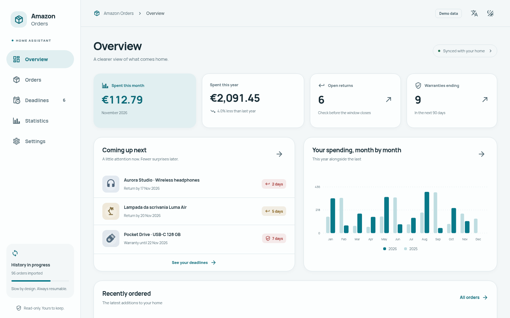
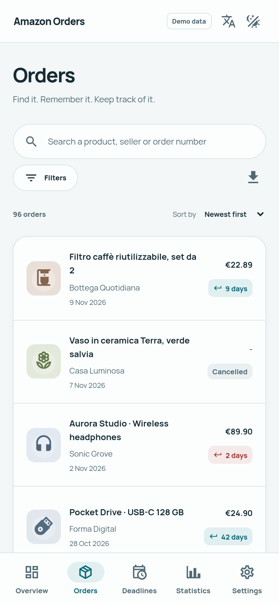
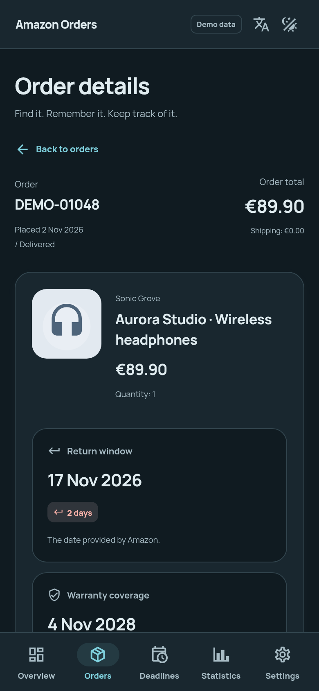
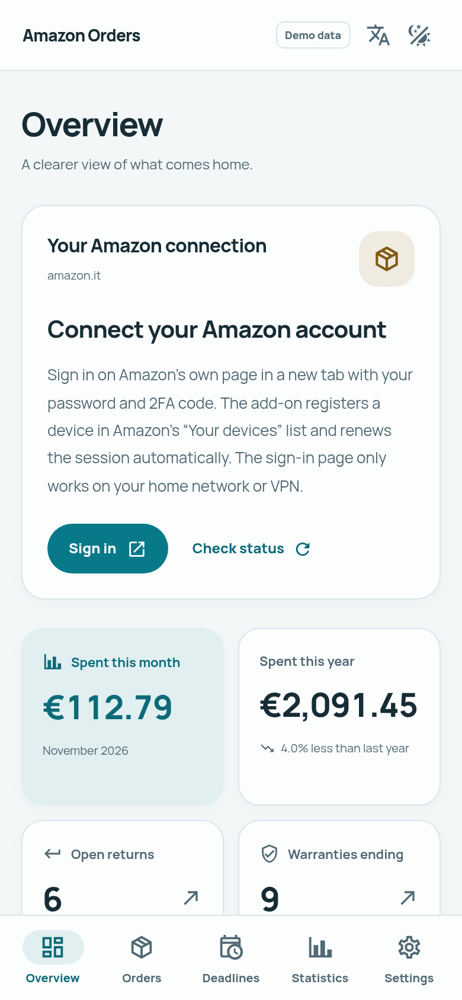
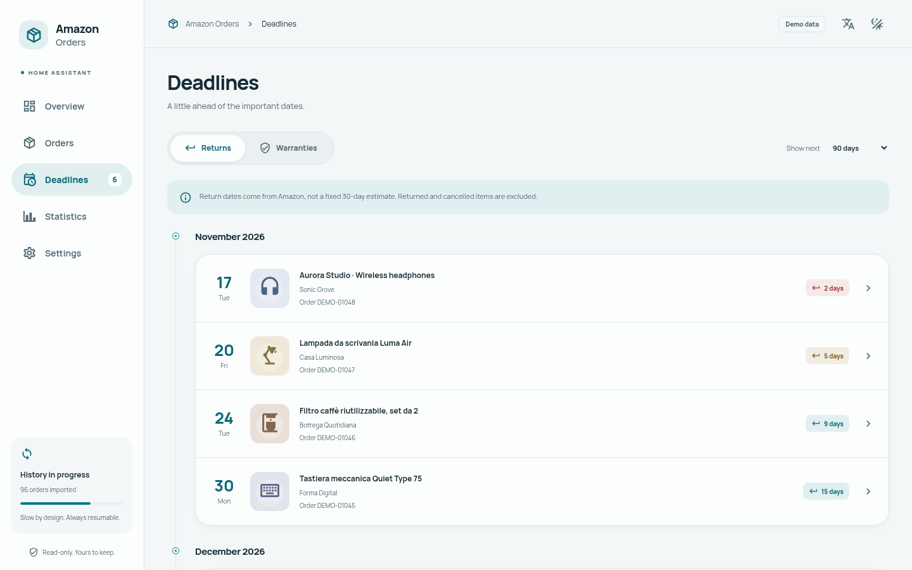
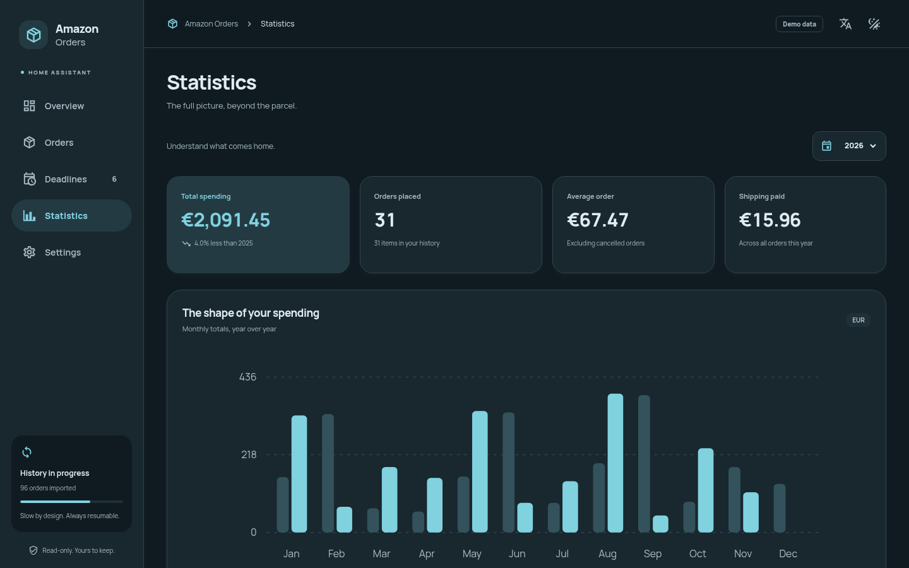

# ha-amazon-orders

A read-only Home Assistant add-on for your Amazon order history. Search your orders, see when return windows and the 2-year legal warranty expire, compute spending statistics, and build your own reminders on Home Assistant events, sensors and a calendar.

Built on top of [`amazon-orders`](https://github.com/alexdlaird/amazon-orders).

> **Status: early development.** Sign-in and order reading are verified against amazon.it; the add-on has not been tested under a real Home Assistant Supervisor yet.

  
  
  

  
  

All screenshots use synthetic demo data. Regenerate them with `pnpm readme:images` in `amazon_orders/frontend`.

## Features

- **Order search**: full-text search over orders and items, with filters by date, seller and status.
- **Return deadlines**: the return window date reported by Amazon for each item (real windows vary from 15 to 85+ days).
- **Warranty deadlines**: the 2-year legal warranty end date, from the delivery date (or the order date when the delivery date is unknown, so the deadline is never later than the real one), with per-item overrides for longer manufacturer warranties.
- **Local annotations**: mark items as kept, to return or returned, and add notes. Stored only in the add-on.
- **Spending statistics**: totals per year and month with year-over-year comparison, per seller, top items, recurring purchases, returns and refunds, shipping paid, plus CSV export.
- **Home Assistant integration**: `amazon_orders_deadline` events at configurable thresholds, summary sensors via MQTT discovery, and an ICS calendar of deadlines.
- **Gentle sync**: slow, resumable backfill of your history with a persistent cache, so Amazon is never hammered. Recent orders refresh every few hours.
- **Sign in once**: you sign in on Amazon's own page (password + 2FA); the add-on registers a device and renews the session by itself.
- **Native look**: follows your Home Assistant theme (light/dark) and language (English, Italian).
- **Read-only**: the add-on never places, changes or cancels orders.

## Compatibility

| Component | Last tested | Date |
|---|---|---|
| Amazon site | amazon.it (pages read in English) | 2026-11-15 |
| `amazon-orders` | 6.0.0 | 2026-11-15 |
| Sign-in | login proxy + registered device with automatic cookie renewal | 2026-11-15 |
| Add-on image | amd64 and aarch64 builds (local, outside Supervisor) | 2026-11-15 |
| Home Assistant OS on Raspberry Pi 5 | not tested yet | |

Other Amazon sites are not supported yet.

## Installation

1. Click the badge above, or in Home Assistant go to **Settings → Add-ons → Add-on Store → ⋮ → Repositories** and add `https://github.com/CristianoCorsi/ha-amazon-orders`.
2. Install **Amazon Orders** and start it.
3. Open it from the sidebar and sign in to Amazon from your home network. See the add-on [documentation](amazon_orders/DOCS.md) for sign-in, entities, events and the calendar.

Requirements:

- Home Assistant OS or Supervised (add-ons are not available on Container or Core installs).
- An MQTT broker (for example the Mosquitto add-on) for the sensors.
- Architecture: aarch64 or amd64.

## Development

- Backend (FastAPI): see [`amazon_orders/backend/README.md`](amazon_orders/backend/README.md). `python -m amazon_orders_ha.dev seed` creates a database of synthetic orders, so you can work without an Amazon account.
- Frontend (SvelteKit): `cd amazon_orders/frontend && pnpm install && pnpm dev` runs the UI on mock data.
- Design documents: [`docs/SPEC.md`](docs/SPEC.md) and [`docs/auth-design.md`](docs/auth-design.md).

## Disclaimer

Amazon offers no public API for customers' orders. This project reads the same pages the Amazon website shows you when you are signed in, so it can break whenever Amazon changes its website, and automated access may be against Amazon's Conditions of Use. For personal use, at your own risk. Not affiliated with or endorsed by Amazon.

## License

[MIT](LICENSE)
